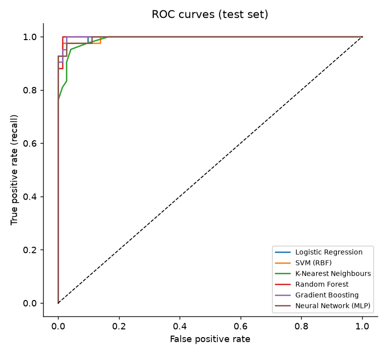

# Predictive Analytics & AI Model Deployment – Tumour Diagnosis

A complete machine-learning pipeline: data preparation, feature engineering, training and comparing six
models, evaluation, and **deployment as a REST API with a web page and a results dashboard**.

> Cognevance Technologies – AI & ML Project Tasks, **Level 3 (Advanced)** · Domain: **Healthcare**

**Problem:** predict whether a breast tumour is **malignant** or **benign** from 30 measurements of cell
nuclei (Breast Cancer Wisconsin – Diagnostic dataset, 569 patients, UCI ML repository).

> ⚠ Educational project only. It is not a medical device and must not be used for real diagnosis.

## Pipeline
```
CSV data → train/test split (80/20, stratified)
        → impute (median) → clip outliers (1st–99th percentile) → engineer 6 ratio/interaction features
        → drop highly correlated features (|r| > 0.95) → standardise
        → 6 models tuned with GridSearchCV (5-fold CV, ROC-AUC) on the training set
        → best model chosen by cross-validation (never by the test set)
        → evaluated once on the held-out test set → saved with joblib
        → Flask API + web UI + dashboard
```
All preprocessing lives **inside** the saved scikit-learn pipeline, so the API treats new patients exactly
as training did. Full details: [docs/ARCHITECTURE.md](docs/ARCHITECTURE.md).

## Technologies
Python · scikit-learn · pandas · NumPy · matplotlib · Flask · joblib · HTML/CSS/JavaScript

## Project structure
```
data/            breast_cancer_wdbc.csv (dataset)
src/             config · data · features (custom transformers) · models · train · plots · predict
models/          best_model.joblib (trained pipeline) · model_meta.json
outputs/         metrics.json · model_comparison.csv · feature_importance.csv · figures/ (7 charts)
templates/       index.html (prediction page) · dashboard.html
tests/           10 unit/API tests
app.py           deployment (API + web pages)         main.py   training + evaluation
docs/            ARCHITECTURE.md                      REPORT.md project report
```

## How to run
```bash
pip install -r requirements.txt

python main.py      # (optional) re-train; the trained model is already included in models/
python app.py       # start the app
```
Then open:
- http://127.0.0.1:5000 – enter measurements (or click "Load malignant/benign sample") and press **Predict**
- http://127.0.0.1:5000/dashboard – model comparison, metrics and charts

Run the tests: `python -m unittest discover -s tests -v`

### Using the API
```powershell
Invoke-RestMethod -Uri http://127.0.0.1:5000/predict -Method Post -ContentType "application/json" `
  -Body '{"mean radius": 17.99, "worst radius": 25.38, "mean concave points": 0.1471}'
```
```json
{"prediction": "Malignant", "probability_malignant": 1.0, "risk_level": "high",
 "features_provided": 3, "features_filled_with_median": 27, "model": "SVM (RBF)", ...}
```
| Endpoint | Method | Purpose |
|---|---|---|
| `/predict` | POST | JSON of any of the 30 feature names → prediction. Missing features use the training median. |
| `/features` | GET | feature names, medians, ranges, sample patients |
| `/health` | GET | status check |
| `/dashboard` | GET | results dashboard |

**Deploying online:** the app is a standard Flask app, so it can be hosted on Render, Railway, PythonAnywhere
or similar (start command: `python app.py`, or `gunicorn app:app` in production).

## Results (held-out test set, 114 patients, 42 malignant)

| Model | CV ROC-AUC | Test accuracy | Precision | Recall | F1 | Test ROC-AUC |
|---|---|---|---|---|---|---|
| **SVM (RBF)** (chosen) | **0.9965** | **0.974** | 1.000 | 0.929 | 0.963 | 0.996 |
| Logistic Regression | 0.9956 | 0.965 | 0.975 | 0.929 | 0.951 | 0.997 |
| Neural Network (MLP) | 0.9941 | 0.965 | 0.975 | 0.929 | 0.951 | 0.996 |
| Gradient Boosting | 0.9940 | 0.956 | 0.974 | 0.905 | 0.938 | 0.998 |
| K-Nearest Neighbours | 0.9935 | 0.930 | 0.947 | 0.857 | 0.900 | 0.991 |
| Random Forest | 0.9916 | 0.956 | 0.974 | 0.905 | 0.938 | 0.998 |

Chosen model on the test set: 39 of 42 malignant tumours caught, 3 missed, 0 false alarms.
The differences between the top models are small and within the noise of a 114-patient test set
(one patient = 2.4 points of recall). See [docs/REPORT.md](docs/REPORT.md) for limitations.

## Screenshots
Add your own to `screenshots/` (prediction page, dashboard, terminal output of `python main.py`) and link them:
```



```
