# AI Pipeline Architecture

## 1. End-to-end workflow

```mermaid
flowchart LR
    A[Dataset CSV<br/>569 patients, 30 features] --> B[Stratified split<br/>80% train / 20% test]
    B --> C[Training pipeline]
    subgraph C [Preprocessing pipeline - one saved object]
      direction LR
      C1[Median imputer] --> C2[Outlier clipper<br/>1st-99th pct] --> C3[Feature engineering<br/>+6 features] --> C4[Correlation filter<br/>r > 0.95] --> C5[Standard scaler] --> C6[Classifier]
    end
    C --> D[6 models x GridSearchCV<br/>5-fold CV, ROC-AUC]
    D --> E[Select best by CV score]
    E --> F[Evaluate once on test set]
    F --> G[best_model.joblib + metadata]
    G --> H[Flask app]
    H --> I[/predict REST API/]
    H --> J[Prediction web page]
    H --> K[Dashboard]
```

(The diagram renders on GitHub.)

## 2. Components
| Layer | File | Responsibility |
|---|---|---|
| Data | `src/data.py` | Loads the CSV (creates it from scikit-learn's bundled dataset the first time); target = malignant (1) vs benign (0) |
| Features | `src/features.py` | `OutlierClipper`, `FeatureEngineer`, `CorrelationFilter` – custom scikit-learn transformers |
| Models | `src/models.py` | Pipeline factory and the 6 candidate models with their parameter grids |
| Training | `src/train.py` | Tuning, cross-validation, test evaluation, permutation importance, saving artefacts |
| Charts | `src/plots.py` | Class balance, correlations, distributions, comparison, ROC, confusion matrix, importance |
| Serving | `src/predict.py` | Input validation, fills missing features with the training median, returns probability and risk level |
| API / UI | `app.py`, `templates/` | Flask routes, prediction page, dashboard |
| Tests | `tests/` | Feature steps, predictor, API endpoints |

## 3. Engineered features
| Feature | Formula | Why |
|---|---|---|
| area_perimeter_ratio | mean area / mean perimeter | size vs outline |
| worst_mean_radius_ratio | worst radius / mean radius | how much the largest nuclei exceed the average |
| worst_mean_concave_ratio | worst concave points / mean concave points | spread of irregular shape |
| radius_variability | radius error / mean radius | uniformity of nuclei size |
| texture_x_smoothness | mean texture × mean smoothness | interaction |
| shape_irregularity | mean concavity + mean compactness | combined irregularity |

## 4. Design decisions
- **Preprocessing inside the pipeline:** no training/serving mismatch, and no leakage because every step is fitted on training data only.
- **Model selection by cross-validation, not by the test set**, so the test score is an honest estimate.
- **Positive class = malignant**, so *recall* means "share of cancers caught", the metric that matters most in screening.
- **Missing inputs allowed:** the API fills absent features with training medians instead of failing.
- **Input validation:** non-numeric, negative, infinite or empty input returns HTTP 400 with a clear message.
